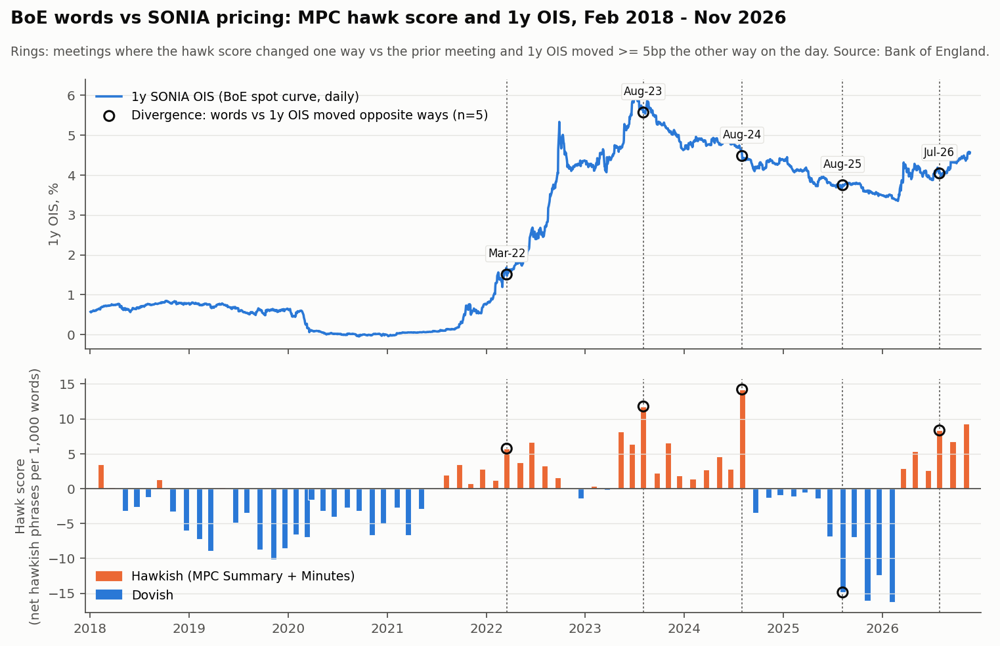

**What it shows:** a transparent hawk/dove score for every Bank of England MPC decision from Feb 2018 to Nov 2026 (73 decisions), built from the Monetary Policy Summary and Minutes.
**It is validated** against the recorded vote split, then set against same-day moves in 6m, 1y and 2y SONIA OIS from the BoE yield-curve files.
**It flags meetings where the words and pricing disagreed.** The words scored hawkish but 1y OIS fell, or the reverse. It also reports where the latest meeting (5 Nov 2026) sits in history.



## Headline (full detail in `results.md`)

| | |
|---|---|
| Score vs net hawkish dissent (level) | r = 0.31 (p = 0.008), n = 72 |
| Score vs committee mean preferred Bank Rate move | r = 0.42, Spearman 0.55, n = 72 |
| d1y OIS on d score (announcement day) | +0.27bp per point, t = 1.45 (HC1 t = 0.68), R^2 = 0.029, n = 71 |
| Divergences (score moved by at least 0.5 SD, 1y OIS moved at least 5bp the other way) | 5 of 71: Mar-22, Aug-23, Aug-24, Aug-25, Jul-26 |
| Latest (Nov 2026, +25bp to 4%, vote 8-1) | score +9.27, 97th percentile, 3rd most hawkish since 2018 |

**How to read it.** The words carry real information about the Committee's stance: they correlate with the votes. But the change in tone on its own explains about 3% of the day's 1y OIS move. Four of the five flagged meetings have the same pattern: the minutes got more hawkish while 1y OIS fell. That includes a hike that softened its guidance (Mar-22, vote 8-1) and the first cut of the cycle (Aug-24, vote 5-4). My hypothesis, which I have not tested: the market traded the decision and its conditional guidance, while the phrase count was still dominated by inflation-persistence language.

## Method

1. **Data (`src/fetch.py`)**
   - MPC pages come from `bankofengland.co.uk/monetary-policy-summary-and-minutes/YYYY/month-YYYY`. The listing page is rendered by JavaScript and there is no sitemap, so the script enumerates months and keeps the pages that return HTTP 200. The two March 2020 special meetings are added by hand.
   - The full minutes are taken from the linked PDF on each page, because pages before Nov 2021 show only the Summary.
   - OIS data is the BoE "UK OIS curve" daily spot curve: `oisddata.zip` plus `latest-yield-curve-data.zip`. Nothing was blocked, so the IADB fallback was not needed.
2. **Votes (`src/parse.py`)**
   - The headline split comes from the Summary (e.g. "majority of 7-2").
   - Each dissenter's preferred move comes from the minutes' vote paragraph.
   - From these: hike/hold/cut member counts, net hawkish dissent (members wanting a higher rate than the decision minus those wanting lower), and the committee mean preferred move in bp.
   - Automated checks: parsed dissents equal the headline split for all 73 decisions, and every decision equals the change in the Bank Rate path.
   - There is one documented override: Aug 2025's two-round vote.
3. **Score (`src/score.py`, `lexicon.csv`)**
   - The lexicon has 104 phrases in six categories: tightening, inflation persistence and upside risk (+1), and easing, slack and downside risk (-1).
   - Longest phrases are matched first. A negator within 3 tokens before a phrase flips its sign ("limited evidence of knock-on effects" scores dovish).
   - Score = net hits per 1,000 words.
   - Vote sentences are stripped before scoring, so the score cannot mechanically encode the votes it is validated against.
   - The lexicon was written before any result was seen and was not tuned.
4. **Market and tests (`src/market.py`, `src/analyse.py`)**
   - The OIS move is measured from the BoE close on the business day before the announcement to the close on announcement day. Decisions are released at 12:00.
   - The regression is OLS with classical and HC1 standard errors.
   - The divergence thresholds are constants at the top of `analyse.py`.

## Run

```sh
python3 -m venv .venv && .venv/bin/pip install -r requirements.txt
./run.sh            # fetch (cached) -> parse -> score -> market -> analyse -> pytest
```

Outputs:

- `results.md`
- `chart.png`
- `data/processed/events.csv`: one row per decision, with vote, score, top phrases and OIS moves
- `data/processed/divergences.csv`
- `data/processed/results.json`

Raw Bank of England downloads (~50MB) are not committed: the first `./run.sh` fetches them into `data/raw/`. Processed outputs are committed, so the results can be read without running anything.

## Limitations

- **The window is close-to-close daily.** Same-day data releases add noise.
- **There is no measure of market expectations.** The day's move is dominated by the decision and vote versus what was priced, plus the MPR and the press conference.
- **A bag of phrases cannot read conditionality or attribution.** It also scores 'weaker sterling', which is inflationary, as dovish.
- **The minutes changed format over the sample.** From 2024 they are shorter and include per-member views.
- **The sample is about 70 meetings across several distinct regimes.** The full list is in `results.md`.

No API keys, no paid data and no LLM calls: the pipeline is deterministic and auditable end to end.
